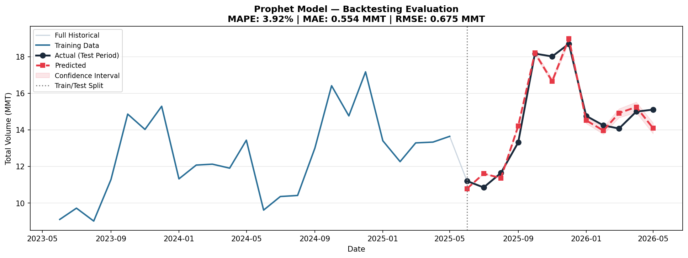

# TradeFlow Forecast
### Cargo Import/Export Volume Analytics & Monthly Forecasting


---

## Overview

**TradeFlow Forecast** is a self-initiated cargo-volume analytics and forecasting prototype developed during a **Data Analytics internship at Adani Ports & SEZ Ltd., Hazira (June–July 2026)**. **The project was demonstrated to the internship mentor.**

It explores how Python analytics, Microsoft SQL Server, AWS data-service workflows, Prophet forecasting, and Power BI could support discussions about cargo demand and operational planning. The forecasting evaluation uses **synthetic cargo data**, not confidential Adani Ports records.

> **Project boundary:** Demonstrated to an internship mentor ≠ deployed by Adani Ports, adopted by an operations team, or proven to improve resource allocation. This is an analytics prototype, not a production forecasting service.

---

## Business Problem

Cargo volume changes may affect planning for vessel movements, equipment availability, and staffing. The analytical questions behind the prototype are:

- How does total cargo throughput change across months?
- How do imports, exports, and cargo categories contribute to volume?
- Can a forecasting model reproduce monthly demand patterns in a controlled dataset?
- How might a dashboard communicate volume trends and forecast uncertainty?

**Approach:** Generate a structured cargo dataset, examine trends using Python and SQL, evaluate Prophet against a chronological holdout, and present the analysis through a Power BI project.

**Not claimed:** Measured berth efficiency improvement, crane optimization, cost reduction, or employer adoption.

---

## Project Structure

```text
TradeFlow-Forecast/
├── notebooks/
│   ├── 01_data_generation.ipynb        # Synthetic cargo-category data generator
│   ├── 02_eda_trends.ipynb             # EDA, trend and seasonal analysis
│   ├── 03_forecasting_model.ipynb      # Full-history Prophet forecast
│   ├── 04_evaluation.ipynb             # Chronological holdout evaluation
│   └── connection.ipynb                # Additional connection work
├── sql/
│   ├── 01_schema_creation.sql          # SQL Server table definition
│   ├── 02_trend_queries.sql            # Aggregations and trend queries
│   └── Tradeflow DB.sql                # Additional database script
├── dashboard/
│   └── TradeFlow Forecast BI Dashboard.pbix
├── assets/                              # Plots, screenshots and supporting exports
├── docs/
│   ├── Project_Brief.md
│   ├── PROJECT_LOGBOOK.md
│   └── INSIGHTS.md
├── README.md
└── LICENSE
```

**Note:** The notebooks generate local `data/processed/` files when run. Generated CSVs are not all committed to the repository; there is no need to assume they exist before running the notebooks.

---

## System Architecture

```text
Synthetic cargo-data generator (date × cargo category)
                         │
                         ▼
              Python / Pandas / NumPy
            Cleaning, EDA, aggregation
                         │
          ┌──────────────┼─────────────────┐
          ▼              ▼                 ▼
    SQL Server        Monthly data       Analysis / BI
    schema and        aggregation        dashboard assets
    SQL analysis          │                 │
          │               ▼                 ▼
          │          Prophet model        Power BI
          │               │              (.pbix)
          │               ▼
          │      24-month train /
          │      12-month holdout
          │               │
          │               ▼
          │      MAE, MAPE, RMSE,
          │      interval coverage
          │
          └── AWS S3 / Glue / Athena exploration
               documented by project artifacts
```

The SQL, AWS and Power BI components are represented by repository scripts, files and screenshots. **This verification did not rerun a live, integrated SQL–AWS–Power BI deployment.**

---

## Dataset

| Attribute | Detail |
|---|---|
| Source | **Synthetic**, generated by [`01_data_generation.ipynb`](notebooks/01_data_generation.ipynb) |
| Total records | **3,291** cargo-category records |
| Unique dates | **1,097** dates, with three cargo categories per date |
| Generated range | June 1, 2023 – June 1, 2026 |
| Dataset columns | 11 generated fields |
| Record granularity | One **date × cargo category** combination |
| Cargo groups | Container, dry bulk, liquid cargo |
| Forecast granularity | **Monthly** total cargo volume, after aggregation |
| Location label | Simulated Gujarat Coast / Hazira–Mundra context |
| Disclosure | Not operational or confidential company data |

**Selected columns:** `Record_Date`, `Cargo_Type`, `Import_Volume_MMT`, `Export_Volume_MMT`, `Total_Volume_MMT`, `Vessel_Arrival_Count`, `Avg_Berth_Turnaround_Days`.

The generator explicitly introduces trend, seasonal multipliers, and random variation. Model results on this dataset must **not** be presented as measured seasonality in real port operations.

---

## Tech Stack

| Layer | Technologies | Evidence |
|---|---|---|
| Data generation / EDA | Python, Pandas, NumPy, Matplotlib, Seaborn | [`notebooks/`](notebooks/) |
| Forecasting | Prophet, multiplicative yearly seasonality | [`03_forecasting_model.ipynb`](notebooks/03_forecasting_model.ipynb) |
| Model evaluation | Scikit-learn MAE, NumPy MAPE/RMSE | [`04_evaluation.ipynb`](notebooks/04_evaluation.ipynb) |
| Database analysis | Microsoft SQL Server / T-SQL | [`sql/`](sql/) |
| Cloud exploration | AWS S3, Glue, Athena | Project documentation and screenshots |
| Business intelligence | Power BI Desktop | [`TradeFlow Forecast BI Dashboard.pbix`](dashboard/TradeFlow%20Forecast%20BI%20Dashboard.pbix) |
| Version control | Git, GitHub | This repository |

---

## Model Performance

A **24-month training / 12-month chronological holdout** was used in the evaluation notebook. The evaluation is on **monthly aggregates** from the generated dataset.

| Metric | Independent Colab rerun (October 13, 2026) |
|---|---:|
| Training window | June 2023 – May 2025 (24 months) |
| Holdout window | June 2025 – May 2026 (12 months) |
| Algorithm | Prophet, multiplicative seasonality |
| **MAPE** | **3.92%** |
| **MAE** | **0.554 MMT** |
| **RMSE** | **0.676 MMT** |
| Months inside reported forecast interval | **2 / 12 (16.7%)** |

The original saved notebook output reports **0.675 MMT RMSE**; the independently regenerated-data rerun reports **0.676 MMT**. The difference is small and may depend on numerical precision or library versions. The 3.92% MAPE and 0.554 MMT MAE agree across the two evaluations.

**Important limitation:** Only 2 of 12 holdout observations fell inside the reported Prophet interval. Point-error performance on this controlled dataset is promising, but interval calibration is poor and real-world predictive performance has not been established.

**Evaluation method:** [`notebooks/04_evaluation.ipynb`](notebooks/04_evaluation.ipynb) · **Rerun context:** 2026-10-13, source revision `68c8e6356ff3`.

> The separate full-history forecast notebook also prints **in-sample** fit metrics. Those are **not** the 12-month holdout scores used above.

---

## Key Findings

- **Monthly forecasting pipeline:** Reproducible transformation from generated daily category records to monthly aggregates and Prophet predictions.
- **Synthetic seasonality:** The forecast responds to the generator's deliberately constructed seasonal patterns; those patterns are **not independent empirical findings** about Adani Ports.
- **Holdout error:** The independently rerun model achieved 3.92% MAPE on the generated benchmark.
- **Uncertainty limitation:** Prediction intervals covered just 16.7% of holdout months in that rerun; forecasting intervals need improvement before operational decisions.
- **Technical scope:** SQL queries, visualizations, Power BI files, and AWS exploration artifacts document the wider analytical workflow, without proving deployment.



---

## Phase Completion

| Phase | Deliverable | Status |
|---|---|---|
| 1 | Synthetic data generator and EDA | ✅ Implemented; Python logic rerun |
| 2 | SQL schema and analytical queries | ✅ Files present; execution not independently retested |
| 3 | AWS S3 / Glue / Athena exploration | 📁 Project artifacts present; live cloud path not retested |
| 4 | Prophet forecasting + chronological evaluation | ✅ Independently rerun |
| 5 | Power BI executive dashboard | 📁 `.pbix` exists; not independently launched |
| 6 | Presentation to internship mentor | ✅ Demonstrated, per project author |
| 7 | Production deployment / measurable operational impact | ❌ Not claimed |

---

## Getting Started

### Prerequisites

- Python 3.9+ and Jupyter Notebook / JupyterLab
- Power BI Desktop if you want to open the `.pbix` file
- SQL Server only for the database scripts; an AWS account only for optional cloud exploration

### Setup

```bash
git clone https://github.com/BitsbyBhargav/TradeFlow-Forecast.git
cd TradeFlow-Forecast
python -m pip install pandas numpy matplotlib seaborn prophet scikit-learn jupyter
```

### Recommended Execution Order

Run the notebooks **from the `notebooks/` directory** so relative paths resolve as intended:

1. `01_data_generation.ipynb` — generate 3,291 cargo-category records and a local CSV.
2. `02_eda_trends.ipynb` — run cleaning/EDA and create `clean_cargo_trends.csv`.
3. `04_evaluation.ipynb` — perform the **24/12-month holdout** evaluation.
4. `03_forecasting_model.ipynb` — fit on the full available monthly series for illustrative future projections.
5. Optionally inspect SQL scripts, [`Power BI project`](dashboard/TradeFlow%20Forecast%20BI%20Dashboard.pbix), and charts.

Some exploratory cells expect earlier notebook state; adjust local folders or rerun dependent cells if needed. The notebook sequence is the intended workflow, not a claim that every notebook is packaged as a single-click application.

---

## Limitations & Future Scope

- Validate on approved, representative real-world cargo data before making operational claims.
- Compare Prophet against seasonal-naive baselines and rolling-origin backtests.
- Improve the forecast intervals and document calibration.
- Reproduce SQL, AWS and BI integration end to end in a documented environment.
- Test actual dashboard refresh, access control, and operational usage before describing a production pipeline.

---

## Project Context

**Internship:** Data Analytics, Adani Ports & SEZ Ltd., Hazira, June–July 2026.  
**Contribution:** Self-initiated analytics prototype.  
**Presentation:** **TradeFlow Forecast was demonstrated to the internship mentor.**  
**Data and deployment:** Synthetic benchmark; no confidential operating data or company deployment claimed.

---

## Author

**Bhargav Sonawane**  
Computer Science — Big Data & Cloud Engineering · MIT ADT University

[GitHub](https://github.com/BitsbyBhargav) · [LinkedIn](https://www.linkedin.com/in/bhargav-sonawane-b50605327/) · [Portfolio](https://bitsbybhargav.github.io/)

---

## License

MIT License — see [`LICENSE`](LICENSE).
